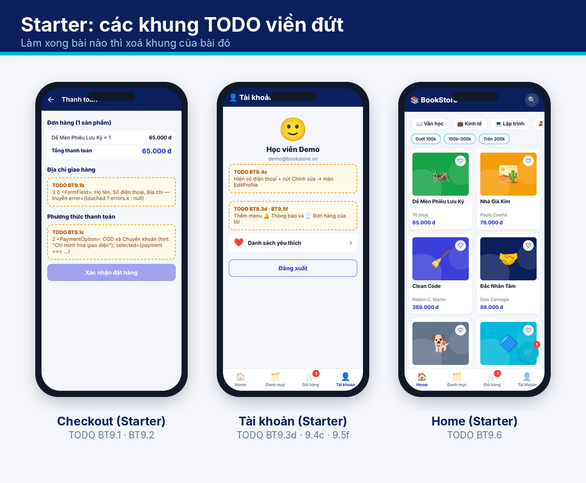
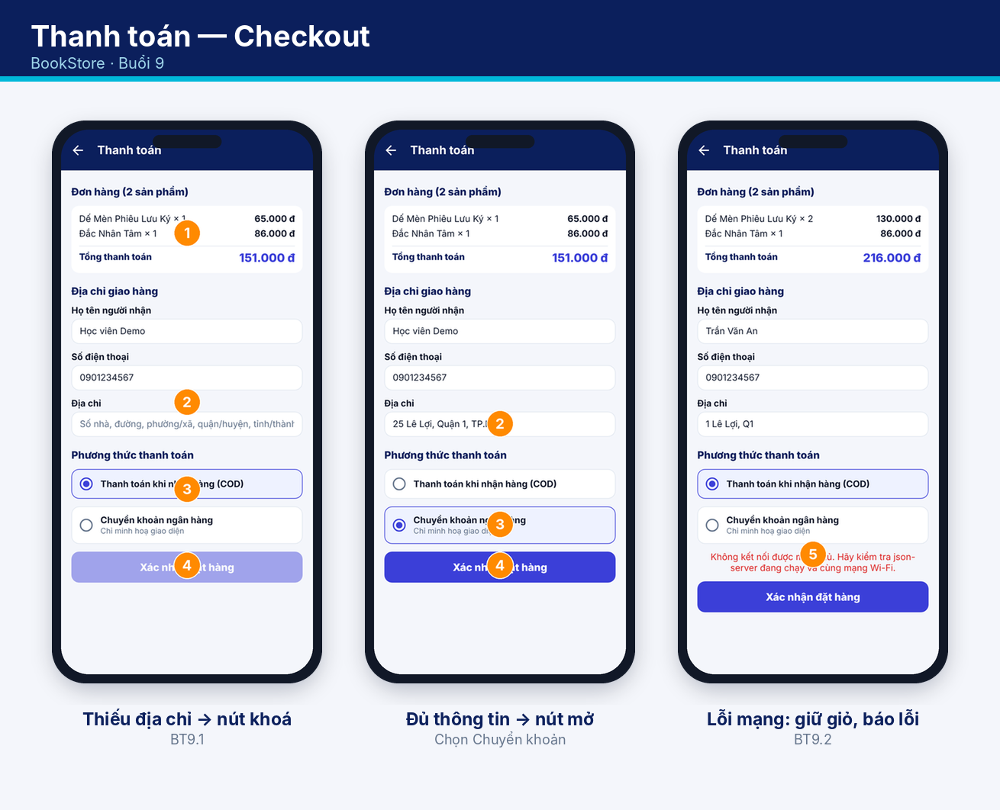
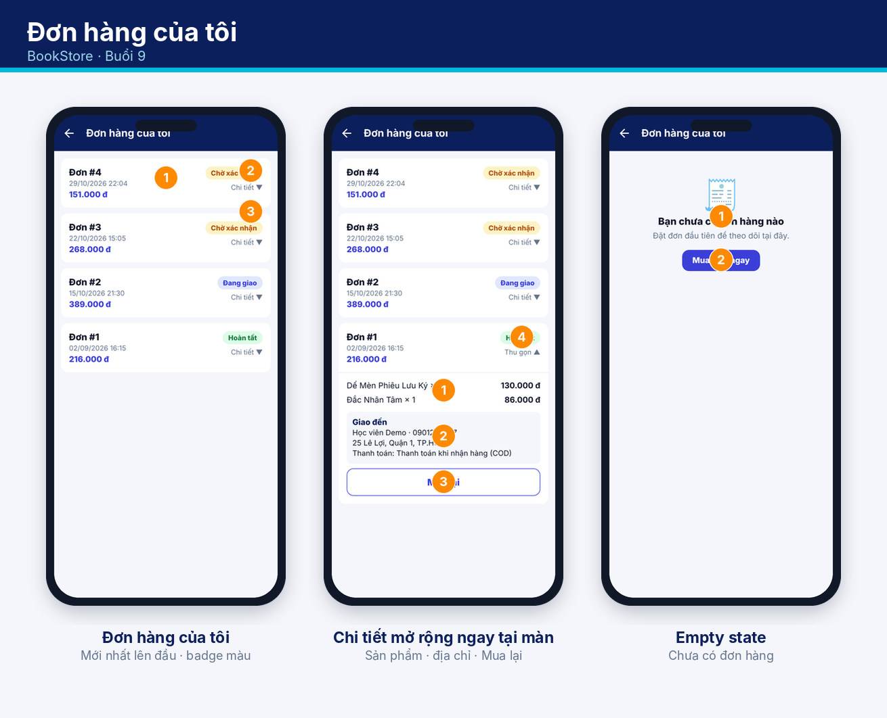
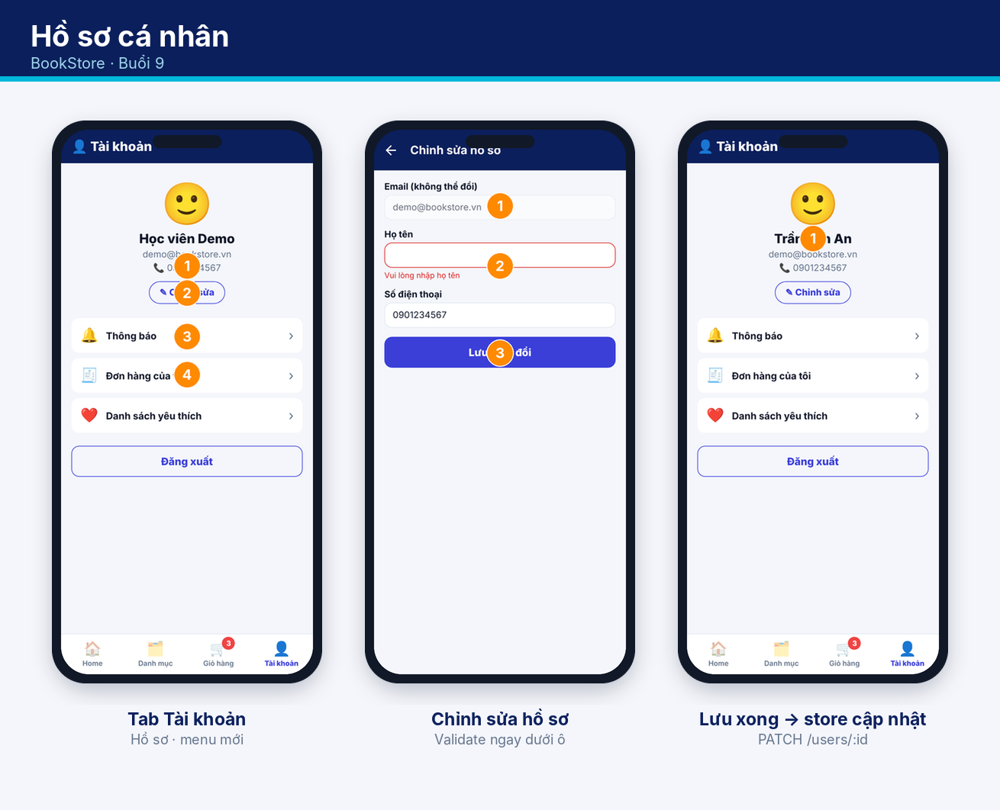
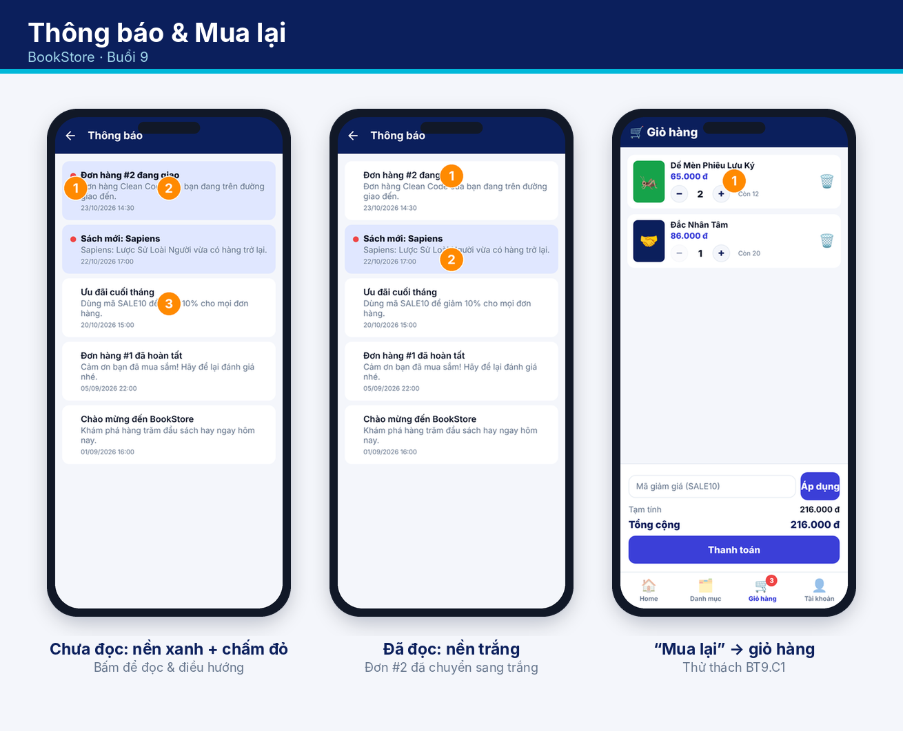
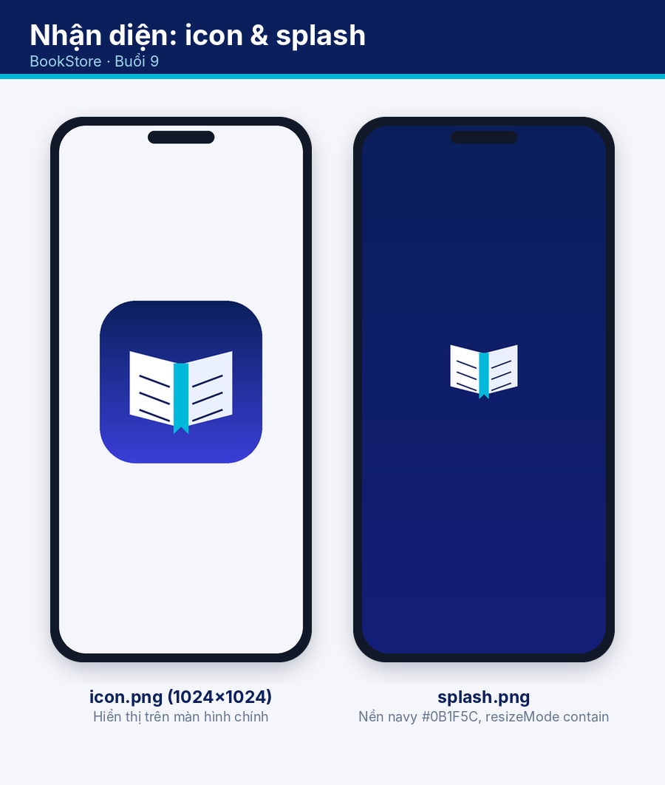

# UI mục tiêu — Buổi 9 (Starter)

Mục tiêu của bạn: làm cho app **trông và chạy giống** các ảnh dưới đây. Mỗi khung viền đứt màu cam trong app là một việc cần làm — làm xong thì xoá khung đó.

## Giao diện đích

## 1. Thanh toán (Checkout) — `docs/ui/01_checkout.png`

1. **Tóm tắt đơn**: tên sách × số lượng, tổng thanh toán (indigo, đậm).
2. **Địa chỉ giao hàng**: Họ tên, Số điện thoại, Địa chỉ; lỗi đỏ hiện dưới ô sau khi người dùng bấm gửi/đã chạm.
3. **Phương thức**: COD hoặc Chuyển khoản (chỉ minh hoạ). Thẻ được chọn có viền + nền indigo nhạt.
4. **Nút "Xác nhận đặt hàng"**: mờ (disabled) khi form chưa hợp lệ hoặc giỏ rỗng; đang gửi hiện spinner.
5. **Lỗi mạng**: giữ nguyên giỏ, hiện thông báo đỏ phía trên nút, bấm lại để thử lại.
Thành công: Alert "Đặt hàng thành công 🎉" → xoá giỏ (store + AsyncStorage) → về Trang chủ.

## 2. Đơn hàng của tôi — `docs/ui/02_orders.png`

1. Thẻ đơn: **Đơn #id**, ngày giờ `dd/MM/yyyy HH:mm`, tổng tiền; đơn mới nhất ở trên cùng.
2. **Badge trạng thái**: chờ xử lý (vàng) · đang giao (xanh dương) · hoàn tất (xanh lá) · đã huỷ (đỏ).
3. Nút **Chi tiết ▼/▲** mở rộng ngay tại màn: danh sách sách, địa chỉ nhận, phương thức thanh toán.
4. **Mua lại** (thử thách) chỉ hiện với đơn hoàn tất → thêm lại sách vào giỏ và chuyển sang tab Giỏ.
Empty state: 🧾 "Bạn chưa có đơn hàng nào" + nút về trang chủ.

## 3. Hồ sơ — `docs/ui/03_profile.png`

1. Tab Tài khoản: tên, email, số điện thoại, nút **✎ Chỉnh sửa**; menu mới 🧾 Đơn hàng của tôi, 🔔 Thông báo.
2. Chỉnh sửa hồ sơ: email **khoá** (mờ), Họ tên + Số điện thoại có validate; nút "Lưu thay đổi".
3. Lưu xong (PATCH /users/:id) → store cập nhật, Tài khoản hiện tên mới ngay.

## 4. Thông báo — `docs/ui/04_notifications.png`

1. Chưa đọc: nền xanh nhạt + chấm đỏ + chữ đậm. Đã đọc: nền trắng.
2. Chạm → cập nhật ngay (optimistic) + PATCH `read:true`, rồi điều hướng tới Đơn hàng / Chi tiết sách.
3. Kéo-để-làm-mới trên Trang chủ (RefreshControl; trên web không có hiệu ứng).

## 5. Nhận diện — `docs/ui/05_branding.png`

`app.json`: name "BookStore", icon 1024², splash nền `#0B1F5C`, adaptive icon, bundle id `com.example.bookstore`.

## Bảng đối chiếu
| Ảnh | Bài |
|---|---|
| 01_checkout | BT9.1, BT9.2 |
| 02_orders | BT9.3, BT9.C1 |
| 03_profile | BT9.4 |
| 04_notifications | BT9.5, BT9.6 |
| 05_branding | BT9.7 |
